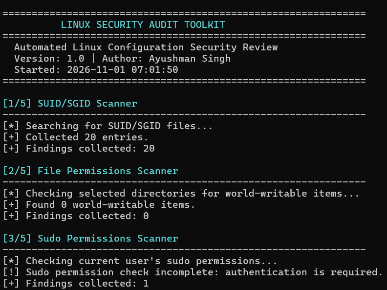
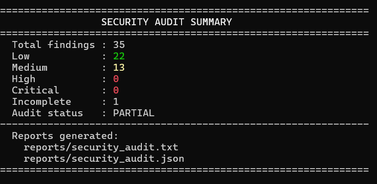

# Linux Privilege Escalation Automation Toolkit

**A Python-based defensive Linux security auditing toolkit**

**Version:** 1.0
**Author:** Ayushman Singh
**Language:** Python 3
**Platform:** Linux / Ubuntu / WSL

---

## Project Overview

The Linux Privilege Escalation Automation Toolkit is a Python-based defensive security auditing project designed to identify potentially risky Linux configurations and prioritize findings for manual review.

The toolkit performs seven security configuration checks, assigns heuristic risk scores, tracks incomplete assessments, and generates human-readable TXT and structured JSON reports.

It is intended for cybersecurity education, internship demonstrations, and authorized defensive security assessments.

**Important:** The toolkit does not perform privilege escalation, exploitation, or automatic remediation.

## Key Features

| Component | Description |
|---|---|
| SUID/SGID Scanner | Identifies files with SUID and SGID permission bits |
| File Permissions Scanner | Reviews selected Linux files and directories for permission concerns |
| Sudo Permissions Scanner | Reviews accessible sudo permissions and identifies authentication limitations |
| Cron Configuration Scanner | Inspects scheduled-task configuration files and their permissions |
| Linux Capabilities Scanner | Identifies assigned file capabilities |
| Systemd Service Scanner | Reviews selected systemd service security configurations |
| Kernel Security Assessment | Collects kernel information and reports CVE assessment limitations |
| System Information | Displays operating system, kernel, user, groups, and architecture |
| Risk Scoring Engine | Assigns heuristic risk scores and severity labels |
| Audit Status Tracking | Identifies incomplete checks and reports partial audits |
| Report Generator | Produces TXT and JSON reports |
| Automated Testing | Includes 38 passing automated tests |

## Technology Stack

- Python 3
- Ubuntu Linux
- Windows Subsystem for Linux (WSL2)
- Linux command-line utilities
- Python standard library
- Python `unittest`
- Git and GitHub

## Project Structure

```text
linux-privesc-toolkit/
├── main.py
├── risk_engine.py
├── report.py
├── generate_sample.py
├── scanners/
│   ├── __init__.py
│   ├── suid_sgid.py
│   ├── permissions.py
│   ├── sudo_checks.py
│   ├── cron_checks.py
│   ├── capabilities.py
│   ├── services.py
│   ├── kernel_security.py
│   └── system_info.py
├── tests/
│   ├── __init__.py
│   ├── test_capabilities.py
│   ├── test_cron_checks.py
│   ├── test_kernel_security.py
│   ├── test_permissions.py
│   ├── test_report.py
│   ├── test_risk_engine.py
│   ├── test_services.py
│   ├── test_sudo_checks.py
│   ├── test_suid_sgid.py
│   └── test_system_info.py
├── examples/
│   ├── sample_security_audit.json
│   └── sample_security_audit.txt
├── reports/
│   ├── security_audit.json
│   └── security_audit.txt
├── screenshots/
│   ├── toolkit-overview.png
│   └── audit-summary.png
├── .gitignore
└── README.md
```

## Installation

### Prerequisites

- Python 3 with virtual environment support
- Linux or Ubuntu on WSL
- Git
- `find` utility
- `getcap` utility from `libcap2-bin`

On Ubuntu, install missing dependencies:

```bash
sudo apt update
sudo apt install python3 python3-venv git findutils libcap2-bin
```

### Clone the Repository

```bash
git clone https://github.com/AyushmanSingh-Cybo/Linux-Privesc-Toolkit.git
cd Linux-Privesc-Toolkit
```

### Create a Virtual Environment

```bash
python3 -m venv .venv
source .venv/bin/activate
```

The core toolkit uses Python standard-library modules.

## Running the Toolkit

Execute:

```bash
python3 main.py
```

The toolkit performs seven security checks:

1. SUID/SGID file review
2. File and directory permission review
3. Sudo permission review
4. Cron configuration review
5. Linux capability review
6. Systemd service configuration review
7. Kernel security information assessment

It also collects system information, calculates preliminary risk scores, tracks incomplete checks, and generates TXT and JSON reports.

## Project Screenshots

### Toolkit Overview



### Security Audit Summary



## Latest Verified Audit

**Environment:** Ubuntu 26.04.1 LTS on WSL2
**Kernel:** 6.18.54.1-microsoft-standard