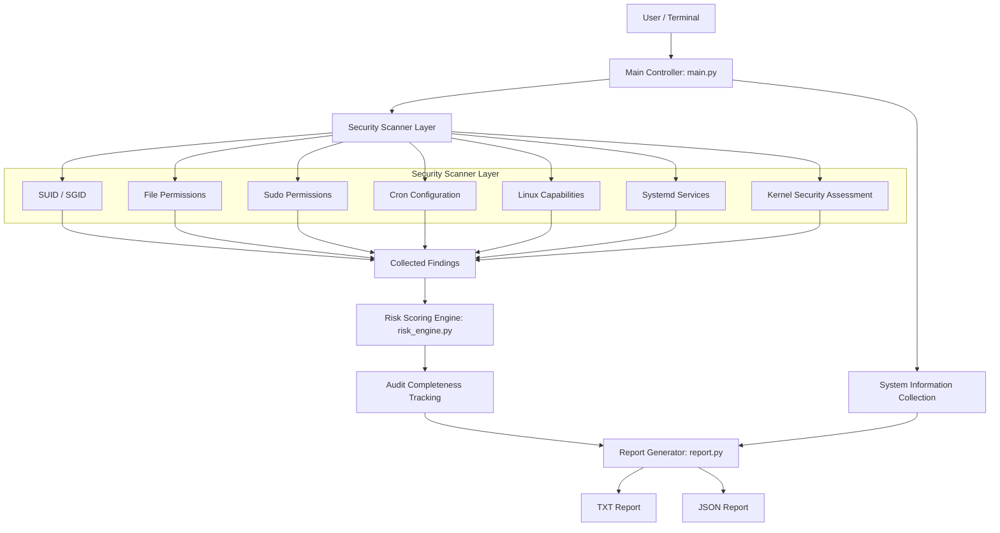

# Linux Security Audit Toolkit — Architecture

## System Architecture

## Component Description

**Main Controller (`main.py`):** Coordinates system information collection, scanner execution, risk scoring, and report generation.

**Security Scanners (`scanners/`):** Perform seven defensive Linux configuration checks.

**Risk Scoring Engine (`risk_engine.py`):** Assigns heuristic review-priority scores and severity labels.

**Audit Completeness Tracking:** Identifies incomplete checks and indicates when an assessment is partial.

**Report Generator (`report.py`):** Produces human-readable TXT and structured JSON reports.

## Security Scope

The toolkit is intended for authorized, read-only configuration assessment. It does not exploit vulnerabilities or attempt privilege escalation.

Kernel CVE matching is not currently implemented. Kernel information is collected, and this limitation is reported.
