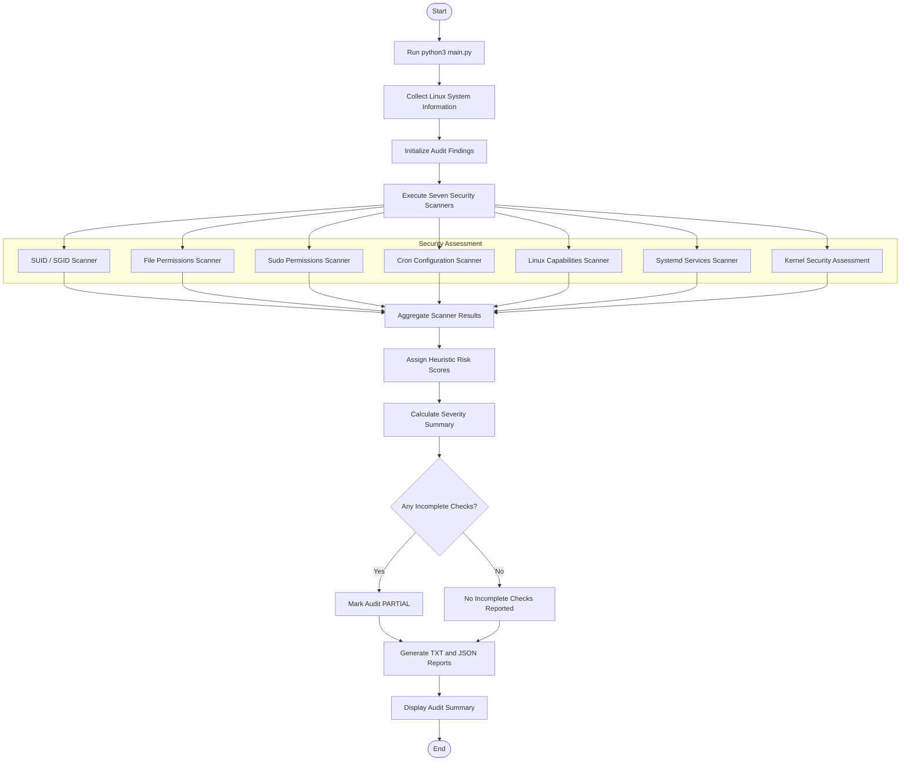

# Linux Security Audit Toolkit — Execution Flowchart

## Audit Execution Flow



## Execution Steps

1. The user starts the toolkit using `python3 main.py`.
2. The application collects Linux system information.
3. Seven defensive security scanners review selected configurations.
4. Scanner findings are collected into a combined results list.
5. The risk engine assigns preliminary risk scores and severity levels.
6. The toolkit calculates the severity distribution.
7. Incomplete checks are identified and the audit status is determined.
8. TXT and JSON reports are generated.
9. The terminal displays the final audit summary.

## Audit Status

**PARTIAL:** One or more checks could not be completed.

**No incomplete checks reported:** All tracked checks completed without reporting an incomplete status. This does not guarantee the system is secure or that every possible security issue was assessed.

## Important Limitations

- Findings are review priorities, not confirmed vulnerabilities.
- The toolkit does not perform exploitation or privilege escalation.
- Kernel CVE matching is not currently implemented.
- Results depend on system configuration, scanner coverage, and user permissions.
```
